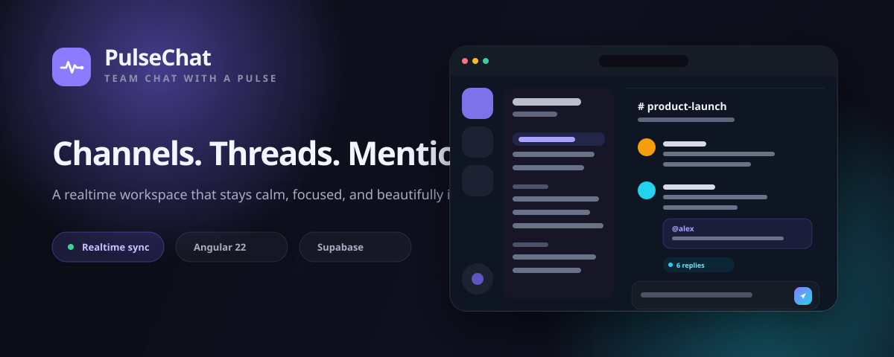

# PulseChat

A polished, realtime team-chat app built with **Angular 22**, **Supabase**, **Tailwind CSS v4**, and **Lucide** icons. Channels, direct messages, threads, mentions, reactions, pins, file sharing, presence, search, and a command palette — with a fully populated demo workspace that works without a backend.



> The demo workspace ships with realistic conversations, attachments, threads, reactions, and simulated replies so you can explore every feature before wiring up Supabase.

---

## Highlights

- **Channels & DMs** — public and private channels, one-to-one messages, starred channels, unread and mention badges.
- **Threads in context** — reply in a side drawer without derailing the channel; reply counts and last-reply times stay in sync.
- **Mentions that matter** — `@handle` autocomplete in the composer, highlight rendering, mention activity feed, and DM shortcuts from a mention.
- **Rich messages** — markdown-style bold/italic/strikethrough, inline code, fenced code blocks, blockquotes, links, emoji reactions, inline editing, delete confirmation, copy text/link, and pinning.
- **Attachments** — drag-and-drop, paste-to-upload, image lightbox, and file cards backed by Supabase Storage (or in-memory blob URLs in demo mode).
- **Virtualized message list** — variable-height virtual scrolling with `@angular/cdk-experimental` `autosize`, day dividers, sender grouping, jump-to-latest, and loading skeletons.
- **Realtime** — Supabase Realtime for messages, reactions, channels, and typing broadcast; presence indicators powered by the online member set.
- **Search & command palette** — workspace-wide message search with highlighting and a ⌘K palette for channels, people, and actions.
- **Members, pins, files & activity panels** — side panel views with direct-message shortcuts and invite-link copy.
- **Profile & appearance** — editable display name, handle, status, avatar upload, presence, dark/light themes, five accent palettes, and a keyboard-shortcut reference.
- **Responsive shell** — persistent workspace rail, desktop sidebar, mobile drawer, and overlay panels on small screens.
- **Demo mode** — seeded local database persisted in `localStorage`, with simulated teammate replies, so the app is fully usable with zero configuration.

---

## Quick start

```bash
npm install
npm start
```

Open <http://localhost:4200>. On the auth screen you can:

1. **Explore the demo** — instant access to a seeded workspace (no account required), or
2. **Sign in / sign up** — if Supabase credentials are present in `.env`.

Environment values are generated automatically by `scripts/generate-env.mjs` before `start` / `build`.

---

## Supabase setup

### 1. Create a project

Create a free project at [supabase.com](https://supabase.com).

### 2. Run the schema

Open **Dashboard → SQL → New query**, paste the contents of [`supabase/schema.sql`](supabase/schema.sql), and run it. The script creates:

- `profiles`, `workspaces`, `workspace_members`
- `channels` (with `dm_key`, `last_message_at`, `last_message_preview`), `channel_members`, `channel_reads`
- `messages` (threads, pins, reply aggregates), `reactions`
- Row-level-security helpers and policies for every table
- Profile-creation trigger on `auth.users`
- Message aggregate triggers (thread counts + channel previews)
- `get_unread_counts()` and `set_message_pin()` RPCs
- A public `chat-attachments` storage bucket with policies
- Realtime publication entries for `messages`, `reactions`, and `channels`

The script is idempotent — re-running it is safe.

### 3. Configure auth

In **Authentication → Providers → Email**, enable email auth. For the smoothest local development, disable **Confirm email** (otherwise new accounts must confirm before signing in).

### 4. Add credentials

Copy `.env.example` to `.env` and fill in:

```dotenv
SUPABASE_URL="https://YOUR-PROJECT.supabase.co"
SUPABASE_ANON_KEY="YOUR-ANON-PUBLIC-KEY"
```

Find both under **Project Settings → API**. `npm start` and `npm run build` regenerate `src/environments/environment.generated.ts` from `.env`.

> Leave the values empty to force demo mode. Never commit `.env` — it is gitignored.

### 5. Create your first workspace

Sign up, then use the onboarding screen to create a workspace. The app seeds `#general` and `#random`. Invite teammates by adding their profile to `workspace_members` (a future in-app invite flow can call the same insert).

---

## Demo mode

Demo mode activates automatically when Supabase is not configured, or when you choose **Explore the demo workspace** on the auth screen. It includes:

- Two workspaces, multiple channels and DMs
- Seeded messages, threads, reactions, pins, attachments, and read state
- 7 realistic teammate profiles with presence
- Simulated typing and replies after you send a message
- Local persistence (`localStorage`) for messages, reactions, drafts, stars, and reads
- A **Reset demo data** action in Profile & settings

All CRUD, threading, reactions, pins, search, and reads work against the local store using the same UI paths as Supabase.

---

## Scripts

| Command | Description |
| --- | --- |
| `npm start` | Generate env, start dev server on `:4200` |
| `npm run build` | Generate env, production build into `dist/` |
| `npm run watch` | Development build in watch mode |
| `npm test` | Run unit tests with Vitest |
| `npm run env` | Regenerate `environment.generated.ts` only |

---

## Keyboard shortcuts

| Shortcut | Action |
| --- | --- |
| `⌘/Ctrl + K` | Open command palette |
| `⌘/Ctrl + Shift + K` | Search messages in the channel |
| `⌘/Ctrl + Shift + N` | Create a channel |
| `⌘/Ctrl + Shift + M` | Open the members panel |
| `Esc` | Close panels, threads, and dialogs |
| `Shift + Enter` | New line in the composer |
| `↑` / `↓` | Move through palette results |

---

## Project structure

```
src/app/
├── core/
│   ├── demo/            # seeded local database + demo store
│   ├── guards/          # auth / guest guards
│   ├── models/          # shared TypeScript interfaces
│   └── services/        # auth, chat state, Supabase, theme, toast, upload
├── features/
│   ├── auth/            # split-screen sign in / sign up / demo
│   └── workspace/       # shell + rail, sidebar, header, composer, list,
│                        # thread drawer, side panel, dialogs, palette
├── shared/              # avatar, logo, toasts, pipes, directives, emoji data
└── styles.css           # design tokens, light/dark themes, components
```

`ChatStateService` is the single source of truth. It abstracts the Supabase and demo backends behind the same API and exposes Angular signals for every view.

### Design system

- CSS custom properties for surfaces, borders, text, accents, and shadows
- Dark-first glassmorphism with a light mode
- Five accent palettes (`violet`, `cyan`, `rose`, `emerald`, `amber`) persisted to `localStorage`
- Motion tuned for reduced-motion preferences
- Accessible focus rings, ARIA labels, keyboard navigation, and semantic landmarks

---

## Security notes

- All Supabase tables use RLS; helper functions are `SECURITY DEFINER` with a locked `search_path`.
- Message HTML is escaped before markdown and mentions are rendered — no raw `innerHTML` from user input without sanitization.
- The `chat-attachments` bucket is public for simple image rendering. Swap the read policy for signed URLs if attachments must be private.
- The anon key is safe to expose in the browser; RLS is what protects data. The service-role key must never be shipped to the client.

---

## Troubleshooting

| Symptom | Fix |
| --- | --- |
| Stuck on “Preparing your workspace…” | Check the browser console; verify `.env` values and that `supabase/schema.sql` ran successfully. |
| Email sign-up works but profile is missing | Re-run the trigger section of `schema.sql` or confirm the project has the `on_auth_user_created` trigger. |
| Realtime messages do not appear | Ensure `messages` is in the `supabase_realtime` publication (the schema adds it) and that both users are channel members. |
| “Could not create channel” | Confirm the workspace membership row exists and the channel name is unique. |
| Demo data looks stale | Profile & settings → **Reset demo data**. |

---

Built with Angular 22, Supabase, Tailwind CSS v4, Lucide, and the Angular CDK.
